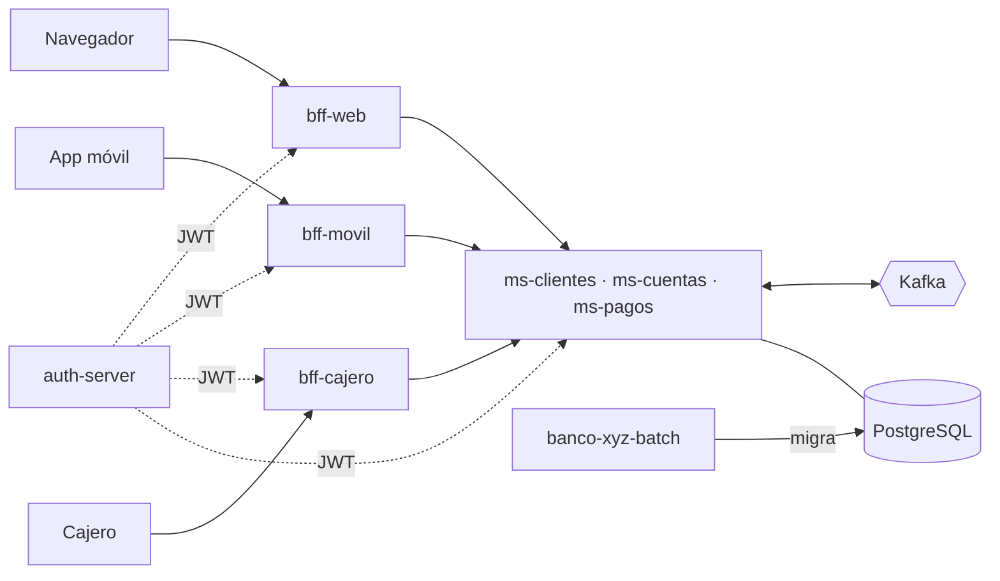

# Banco XYZ - Evaluación Final Transversal (Desarrollo Backend III)

| Parte | Módulos | Descripción |
|---|---|---|
| 1. Migración batch | [`banco-xyz-batch`](banco-xyz-batch/README.md) | Spring Batch que migra los CSV de `fin_legacy_data/semana_3` a PostgreSQL |
| 2. BFF por canal | `bff-web`, `bff-movil`, `bff-cajero` | Una API por canal, con HTTPS, tokens delegados y mTLS en el cajero |
| 3. Microservicios | `ms-clientes`, `ms-cuentas`, `ms-pagos` + `config-server`, `discovery-server`, `auth-server`, Kafka | Clientes, cuentas y pagos comunicados por eventos |

Otros documentos:
- [`instrucciones.md`](instrucciones.md): paso a paso para ejecutar y probar todo.
- [`despliegue.md`](despliegue.md): cómo llevar el sistema a AWS.

## Arquitectura



Hay una sola base `banco_xyz` y cada microservicio usa solo sus tablas. Al iniciar, `ms-clientes` y `ms-cuentas` toman los datos que dejó el batch: cada titular es un cliente y cada cuenta conserva su id y su saldo.

## Microservicios

| Servicio | Qué hace | Publica | Consume |
|---|---|---|---|
| **ms-clientes** | Datos del cliente, perfil y notificaciones | `banco.clientes.eventos` | `banco.cuentas.eventos`, `banco.transacciones.completadas`, `banco.alertas.seguridad` |
| **ms-cuentas** | Cuentas, saldos y cartola. Es el único que mueve dinero | `banco.cuentas.eventos`, `banco.operaciones.resultados`, `banco.alertas.seguridad` | `banco.clientes.eventos`, `banco.operaciones.solicitadas` |
| **ms-pagos** | Pagos, transferencias y depósitos | `banco.operaciones.solicitadas`, `banco.transacciones.completadas`, `banco.alertas.seguridad` | `banco.operaciones.resultados` |

Todos los tópicos tienen 3 particiones y un tópico `-dlt` para los mensajes con error.

### Flujo de un pago

1. El cliente hace `POST /api/pagos` y ms-pagos guarda la operación como `PENDIENTE` y responde `202`.
2. ms-pagos envía el evento `OperacionSolicitada` por Kafka.
3. ms-cuentas aplica el débito y responde `APLICADA` o `RECHAZADA`.
4. ms-pagos cierra la operación como `COMPLETADA` o `RECHAZADA`.
5. ms-clientes recibe el evento y notifica al cliente.

### Garantías

- **Outbox**: el evento se guarda junto al cambio de negocio y se publica después. Si Kafka está caído, no se pierde.
- **Consumidor idempotente**: un mensaje repetido no mueve el saldo dos veces.
- **Errores**: un mensaje inválido va al `-dlt`. Si la base o un circuito está caído, se reintenta con espera.
- **Idempotency-Key**: reenviar el mismo POST devuelve la misma operación.
- Una operación `PENDIENTE` por más de 60 s se vuelve a solicitar (hasta 5 veces).

## Resiliencia (Resilience4j)

| Circuito | Dónde | Si falla |
|---|---|---|
| `msCuentas` (+ 3 reintentos) | ms-pagos -> ms-cuentas | La operación se acepta con validación `DIFERIDA` |
| `msCuentas` | ms-clientes -> ms-cuentas | El perfil se entrega sin cuentas (`cuentasDisponibles=false`) |
| `cuentasDb` / `clientesDb` | servicio -> PostgreSQL | Responde 503 (y ms-cuentas pausa sus consumidores Kafka) |
| `kafka` | publicación del outbox | Los eventos esperan en la tabla y salen al recuperarse |

## Seguridad

`auth-server` emite un JWT (RSA) tras el login con GitHub. Cada microservicio valida firma, emisor, audiencia y expiración. Los permisos son:

| Scope | Permite |
|---|---|
| `clientes.read` / `clientes.write` | consultar / modificar clientes |
| `cuentas.read` / `cuentas.write` | consultar / modificar cuentas |
| `pagos.read` / `pagos.write` | consultar / crear pagos (los retiros solo con token del cajero) |
| `tarjetas.verify` | validar tarjeta y PIN (solo `bff-cajero`) |

Los `.read` los recibe todo usuario autenticado y los `.write` solo los logins de `AUTH_OPERADORES` (si está vacío, todos).

## BFF por canal

Son tres aplicaciones independientes, sin base de datos ni lógica de negocio. Adaptan las respuestas a cada canal.

| | **bff-web** (8443) | **bff-movil** (8444) | **bff-cajero** (8445) |
|---|---|---|---|
| Autenticación | JWT del login | JWT + `X-Device-Id` | Certificado del cajero (mTLS) + tarjeta y PIN |
| Respuestas | Completas (panel con cliente, cuentas, movimientos y notificaciones) | Livianas (cuentas enmascaradas, paginado de 10, gzip y ETag) | Mínimas (saldo y resultado del retiro) |
| Operaciones | Pagos, transferencias, abrir cuenta, editar datos | Pagos y transferencias hasta $500.000 | Saldo y retiros ($5.000 a $200.000, múltiplos de $5.000) |
| Token al backend | `canal=web`, 5 min | `canal=movil`, 5 min, sin permisos de escritura de cuentas y clientes | `canal=cajero`, 2 min, ligado a una cuenta y un terminal |

**Tokens delegados:** el token del usuario no llega a los microservicios. Cada BFF lo cambia en el `auth-server` por un token corto del canal, con los permisos que tienen en común el usuario y el canal.

**Protección BOLA/IDOR:** cada cuenta u operación pedida se compara con el cliente del token. Si es de otro cliente, responde `403`.

**Certificados:** una CA de desarrollo firma el HTTPS de los BFF y otra firma los certificados de los cajeros. `bff-cajero` solo confía en esta segunda. Se generan con `certificados/generar-certificados.sh`.

## Ejecutar

Se necesita Docker Desktop con 8 GB de RAM (son 13 contenedores). Copiar `.env.example` a `.env` y completar `GITHUB_CLIENT_ID` y `GITHUB_CLIENT_SECRET` (callback de la OAuth App: `http://localhost:9000/login/oauth2/code/github`).

```bash
docker compose up -d --build
docker compose ps     # banco-xyz-batch: Exited (0), el resto: healthy
```

| URL | Qué es |
|---|---|
| http://localhost:8761 | Eureka (`eureka` / `eureka2026`) |
| http://localhost:8090 | Kafka UI |
| http://localhost:9000/oauth2/authorization/github | Login (entrega el `accessToken`) |

**Escalar:**
```bash
docker compose up -d --scale ms-cuentas=3 --scale ms-pagos=2
```
Las réplicas se registran en Eureka, las llamadas se reparten entre ellas y las particiones de Kafka se distribuyen entre las réplicas.

Las pruebas con `curl` de cada servicio, de los BFF y de tolerancia a fallos están en [`instrucciones.md`](instrucciones.md).

## Puertos

| Servicio | Puerto |
|---|---|
| ms-clientes / ms-cuentas / ms-pagos | 8101 / 8201 / 8301 (réplicas hasta +2) |
| bff-web / bff-movil / bff-cajero | 8443 / 8444 / 8445 (HTTPS) |
| config-server / discovery-server / auth-server | 8888 / 8761 / 9000 |
| Kafka / Kafka UI | 9092 / 8090 |
| PostgreSQL | 5433 |